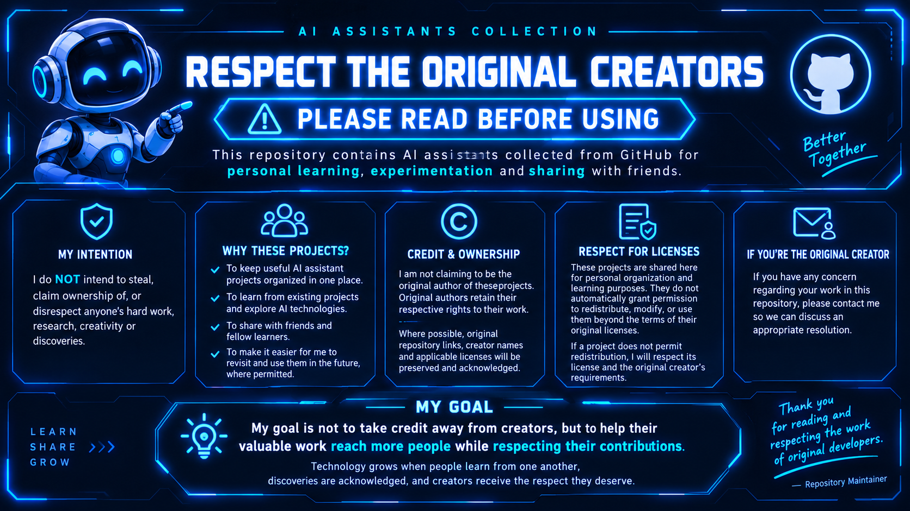

# ⚠️ IMPORTANT — PLEASE READ BEFORE USING

## 🤝 Respect the Original Creators

Welcome to my personal AI Assistants Collection!

**My intention is to share knowledge, not to steal anyone's hard work or claim ownership of someone else's discoveries.**

### 🎯 Purpose of This Repository

- To organize AI assistant projects for personal learning and experimentation.
- To share interesting projects with friends and fellow learners.
- To revisit and use these projects in the future, where permitted.

### ©️ Credit & Ownership

I do not claim to be the original creator of projects developed by others. All original creators retain their respective rights.

Where possible, I will acknowledge the original developers and provide links to their original repositories.

### 📜 License & Usage

Please check each project's original license before using, modifying, or redistributing its code. Uploading a project here does not override its original license or grant additional permissions.

If a project's license does not permit redistribution, I will respect the creator's terms.

### 💙 My Message

**Learn from others. Give credit where it is due. Share knowledge responsibly.**

My goal is to help valuable work reach more people while respecting the people who created it.

Thank you for visiting!

— Repository Maintainer
